# Hi, I'm Khang 👋

**AI / RAG Engineer** building 100% local, grounded question-answering systems — hybrid retrieval, reranking and graph-based context over real documents, with no paid API.

Based in Ho Chi Minh City · Background in data engineering (real-time & batch pipelines)

## Tech Stack

## Featured Projects

| Project | What it does | Stack |
|---|---|---|
| [**rag-chatbot-document-QA**](https://github.com/nguyenkhang-1902/rag-chatbot-document-QA) | 100% local RAG chatbot for document Q&A (.md / .docx / .pdf). Hybrid search + reranker, **97.7% Recall@4**, no paid API. | LangChain · Chroma · Ollama · FastAPI · Streamlit |
| [**graph-rag-legal-qa**](https://github.com/nguyenkhang-1902/graph-rag-legal-qa) 🚧 *in progress* | Graph RAG for Vietnamese legal documents: vector retrieval plus citation graph traversal. | Neo4j · Chroma · Ollama |
| [**recruitment-cdc-pipeline**](https://github.com/nguyenkhang-1902/recruitment-cdc-pipeline) | Real-time CDC pipeline (Kappa architecture) cutting data latency from 24h to **under 30s**. | Kafka · Spark Streaming · Cassandra · Airflow |

## GitHub Stats

  
  

## Contact

<!-- TODO: add email / LinkedIn once decided -->
- GitHub: [@nguyenkhang-1902](https://github.com/nguyenkhang-1902)
